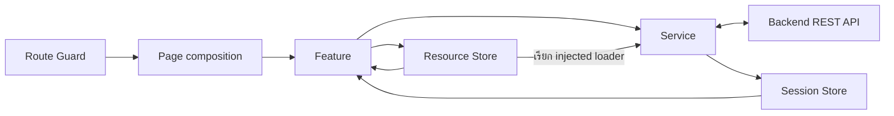

# Web Architecture

## Layers

โครงสร้างรักษา DOM, copy, URL/options, abort/retry, focus และ identity generation เดิม ธีมอยู่ที่ [DESIGN](DESIGN.md)



Guard อยู่ใน JSX ที่ Page ประกอบและเลือก feature slot ตาม session โดยไม่มี redirect; ลูกศรเป็นลำดับหน้าที่ ไม่ใช่ import ของ guard กลับไป page. SessionProvider ใน features/auth สร้าง store แล้ว inject ให้ session-service; service publish safe session ลง sink โดยตรง. Map feature ส่ง domain service loader ผ่าน useResource ไปยัง resource-store.load; resource-store เป็นผู้เรียก injected loader และ publish response/error ลง slice ของ map-store โดยไม่ import service runtime

| Layer         | May import                                                     | Rule                                                                                                                                                                                                                                                                                                                     |
| ------------- | -------------------------------------------------------------- | ------------------------------------------------------------------------------------------------------------------------------------------------------------------------------------------------------------------------------------------------------------------------------------------------------------------------ |
| app           | app, features, guards, lib, assets                             | page / ใช้ MapWorkspace, SessionControls, SessionRoute; /login ใช้ LoginForm, SessionRoute และ demoAccounts(process.env) แบบ force-dynamic; layout ใช้ SessionProvider และ SessionNotices จาก features/auth, font และ CSS จาก assets; proxy route ใช้ lib/proxy; health ใช้ platform Response ไม่มี fetch/business state |
| guards        | guards, stores, lib values/types, React                        | เลือก slots/visibility เท่านั้น ไม่เรียก API หรือ redirect และไม่แทน server authorization                                                                                                                                                                                                                                |
| features      | features, guards, services, stores, components/ui, lib, assets | UI/hooks และ wiring; ไม่เรียก transport หรือประกอบ /api/ URL                                                                                                                                                                                                                                                             |
| services      | services, lib; store types เท่านั้น                            | สร้าง URL และเรียก REST; session-service เขียน injected sink; ไม่ import React/react-dom/Next หรือ store runtime                                                                                                                                                                                                         |
| stores        | stores, lib                                                    | state container, selectors, resource identity/abort guards; React adapters เฉพาะ map-store.ts และ session-context.tsx; ไม่ import services                                                                                                                                                                               |
| components/ui | components, React, UI packages                                 | ไม่ import stores/services/features                                                                                                                                                                                                                                                                                      |
| lib           | lib                                                            | pure helpers/types; proxy.ts เป็น server transport adapter ที่รับ fetcher ได้                                                                                                                                                                                                                                            |

Assets มีเฉพาะ style/font/icon; app และ features import assets ได้ แต่ assets ห้าม import layer อื่น ไม่มี service/state ใน assets

## Boundary checks

`test/architecture.test.mjs` ใช้ TypeScript AST สแกน src ทั้ง .ts/.tsx/.js/.jsx/.mjs ตรวจ static import/export, dynamic import() และ require() ที่ target เป็น string คงที่ (target คำนวณถูกปฏิเสธ). ตรวจทิศทางข้าม layer รวม alias @/, stores ห้าม services และ services รับได้เฉพาะ store types. Relative value imports ใน lib/services/stores ต้องลงท้าย .ts. Bare package imports ใช้ allowlist แยก layer ตาม imports ปัจจุบัน (features อนุญาต react/react-dom, next/link, next/navigation, next/dynamic, maplibre-gl); services ไม่มี bare package, stores ใช้ React เฉพาะ adapters, lib ใช้ geojson types, app ใช้ next/react types. lib/proxy import ได้เฉพาะ app/api/** รวม relative/alias และ re-export. Pure layers ห้าม package ที่ตรง `^(react|react-dom|next)(/|$)`; React exceptions มีรายชื่อชัดเจน

นอก services และ lib/proxy.ts ปฏิเสธ identifier fetch รวมการเก็บเป็น alias, XMLHttpRequest, sendBeacon, EventSource, WebSocket และ bracket property แบบ literal. ทุก layer ห้าม /api/ ใน string/template literals ยกเว้น services, lib/proxy.ts และ app/api/**. App ห้าม runtime import จาก react; checker ไม่ได้พิสูจน์ business logic ทุกชนิดหรือ computed transport aliases ทุกรูปแบบ. Negative self-tests ป้อน source ที่ผิดใน memory เพื่อพิสูจน์แต่ละ rule; ไม่มี dependency เพิ่ม

## Folder map

```text
src/app/                   /, /login, layout, /api/[...path], /health
src/assets/styles/         globals.css (Tailwind v4 theme), maplibre.css
src/assets/fonts/          fonts.ts (next/font IBM Plex Sans Thai)
src/assets/icons/          login-icons (inline SVG)
src/guards/                session-guard: SessionRoute, GuestOnly, AccountOnly, RequireRole
src/features/auth/         login-form, session-controls, session-provider
src/features/map/          map-workspace, top-nav, filters-panel, site-list, sites-table
                           site-popup, survey-popup, legend, map-ui, site-map
                           list-pagination, basemap-select
                           use-resource, use-pagination-focus
src/services/              http-client, auth-service, session-service
                           sites-service, surveys-service, lookups-service, map-cache-service
src/stores/                external-store, session-store, session-context
                           map-store, resource-store
src/components/ui/         button, pagination, alert, select, input, label, tabs, table, badge, card, utils
src/lib/                   map-state, map-format, sites, session, proxy, demo-accounts, basemaps, map-overlay, map-cache
                           map-url, survey-visibility
```

SessionProvider สร้าง session-store + createSessionService(sink, options) ต่อ mount แล้ว expose facade เฉพาะ getSnapshot/getServerSnapshot/subscribe/isCurrent และ service actions โดยไม่เปิด setState ให้ features ที่คง identity ผ่าน useSession. ไม่เรียก /auth/me: ตอน mount อ่าน identity ที่จำไว้ตอน login (localStorage key gis-session เก็บเฉพาะ id/email/role/expires_at ไม่มี JWT) แล้วตั้ง timer เฉพาะเวลาหมดอายุ; API ตรวจ session ทุกคำขอ ถ้า 401 หรือ response มี X-Auth-Session: invalid (http-client onSessionInvalid) จะล้าง identity และแจ้งหมดอายุ; storage event จากแท็บอื่นสั่ง restore ใหม่. ไม่มี focus/visibility listener; dispose ยกเลิก timers และ listener. session-context เก็บแค่ context/subscription ไม่มี service wiring; ตอน hydrate useSession อ่าน getServerSnapshot (สถานะ checking คงที่) เพราะ identity จาก storage อาจถูกอ่านก่อน subtree ที่ hydrate ทีหลัง (แผนที่เป็น dynamic import) แล้ว HTML ไม่ตรงกับ server

MapContent สร้าง map-store ต่อ mount มี filters/page/pageSize (10/20/50/100, เปลี่ยนแล้วกลับหน้า 1)/view/bbox/selectedSite/popup และ resource slices provinces/list/sites/surveys/detail/history. useResource(key, load, retry, resource) subscribe slice ผ่าน useSyncExternalStore; slice ถือ identity key/retry/generation, latestRequest/AbortController และ response/error. Loader ref เปลี่ยนได้โดยไม่ fetch ซ้ำหาก key/retry/generation/session เดิม. MapWorkspace key ตาม session generation จึงโหลดข้อมูลแหล่งจาก URL อีกครั้งด้วย identity ใหม่และทิ้ง payload ของ session เดิม

State ที่ยัง local มี basemap ที่เลือก (อ่าน/เขียน localStorage gis-basemap หลัง mount; SiteMap สลับเฉพาะ raster source ใต้ชั้นข้อมูล (ภาพดาวเทียมมี overlay ถนน/ชื่อสถานที่ basemap-overlay-N; tile overlay ที่โหลดไม่ได้ไม่ขึ้นคำเตือน) ไม่สร้างแผนที่ใหม่; ลูกศร popup เป็น element ใน map container ที่ SiteMap จัดตำแหน่งเอง ไม่ผ่าน React state), validation/selection notice, retry counters, pagination metadata, ซูมและสถานะปุ่มเปิด/ปิดชั้นจุดสำรวจ, ข้อมูลที่แผนที่ยังวาดระหว่างโหลด, MapLibre availability/display flags และ DOM/focus refs. เป็นสถานะการแสดงผลของ mount; response/error ของแต่ละคำขออยู่ใน resource slice. geometry cache เป็นของ map-store ต่อ mount ไม่ใช้ singleton หรือ localStorage และไม่เพิ่ม preload

## Page URL

`map-url.ts` parse/serialize ตัวกรอง แหล่งที่เลือก view page และ pageSize ใช้ `filterState` และ `pageSizeState` ตรวจค่าแต่ละตัวแยกกัน MapWorkspace อ่าน query ตอนเริ่มและ restore map-store เมื่อเกิด popstate พร้อมยกเลิก debounce เดิม ตัวกรองใช้ router.replace หลัง 300ms ส่วนเลือกแหล่ง เปลี่ยนแท็บ หรือเปลี่ยน pagination ใช้ router.push แท็บใช้ shadcn Tabs และคง MapLibre instance ไว้เมื่อเปิดตาราง

ชั้นแปลงอ้างอิงมี toggle local ใน MapWorkspace เริ่มปิด SiteMap ลงทะเบียน vector source และเส้นใต้ polygon ของแหล่งที่ zoom 7–16 แผนที่ซูมสูงกว่านั้นใช้ tile จาก zoom 16 คำขอ `GET /tiles/reference_parcels/{z}/{x}/{y}` ผ่าน Next route ไปยัง Martin ที่ `TILES_INTERNAL_URL` เป็น same-origin จึงใช้ CSP เดิม Route จำกัดพิกัด XYZ และชื่อแหล่งที่อนุญาต เก็บ tile สำเร็จใน HTTP cache 5 นาที และส่งไปยัง Martin โดยไม่ส่ง session cookie

## Route guards

Page / ประกอบ SessionRoute ใน sessionControls slot ของ MapWorkspace → TopNav เลือก SessionControls view checking/account/guest; public map เปิดได้ทุกสถานะ. Page /login ประกอบ SessionRoute เลือก LoginForm ไม่ส่ง guest ใน checking (ให้ form อิง session ปัจจุบัน), guest=true เมื่อ anonymous และ guest=false เมื่อ signed-in. ใช้ component ชนิดเดิมที่ตำแหน่งเดิม จึงรักษา form state และ discovery lifecycle. Page (server, `dynamic = 'force-dynamic'`) อ่าน DEMO_VIEWER_PASSWORD/DEMO_EDITOR_PASSWORD/DEMO_ADMIN_PASSWORD ตอน request ผ่าน pure demoAccounts(env) ใน lib (ว่างหรือไม่ตั้งใช้ค่า .env.example) แล้วส่ง prop accounts ให้ LoginForm ทั้งสาม slot; LoginForm ใช้ accounts สำหรับกล่องบัญชีสาธิตและค่า Admin เริ่มต้น (ไม่ส่ง prop ใช้ DEMO_ACCOUNTS) และ features ไม่อ่าน env เอง. LoginForm ยังคง checking/logoutPending controls และ disabled rules เดิม

**/login ไม่ redirect signed-in user** แสดง account controls กับลิงก์กลับแผนที่; router.replace('/') เกิดเฉพาะ login สำเร็จ. RequireRole รับ allowed roles สำหรับ feature controls ในอนาคต; ไม่มี write UI หรือ role redirect ใหม่. GuestOnly/AccountOnly ยังคงเป็น visibility helpers

## Data flow examples

### Load sites in viewport

1. SiteMap debounce moveend600ms (VIEWPORT_DEBOUNCE_MS) → map-store.setBbox; FiltersPanel validate แล้ว debounce300ms commit filters/page1
2. Feature ใช้ sitesService.listKey(state)/geojsonKey(filters,bbox) และ surveysService.geojsonKey ซึ่ง snap bbox ออกสู่ grid 0.25 องศา เป็น resource identity; loader เรียก list/geojson ด้วย domain arguments ไม่สร้าง URL เอง
3. Geometry loaders อ่าน cache ของ map-store ตาม URL key (layer + snapped bbox + filters); cache miss จึงสร้าง relative /api URL ผ่าน mapQuery ส่วน list ใช้ listQuery → http-client → Next proxy → REST API โดยคง query order, credentials same-origin, cache no-store และ signal เดิม
4. useResource ส่ง callback loader ให้ resource.load; resource-store เรียก loader(signal) ซึ่งเรียก service แล้วรับ promise; resource slice ตรวจ latest request + session isCurrent(generation), strip created_by เมื่อ anonymous แล้ว publish; authenticated401 เรียก unauthorized, anonymous401 เป็น retryable error
5. Feature ส่ง collection ให้ SiteMap ขณะโหลด/ล้มเหลวคงข้อมูลเดิมพร้อม stale notice แยก sites/surveys
6. ชั้นจุดสำรวจเปิดเมื่อซูม ≥12 หรือมีแหล่งที่เลือกและผู้ใช้เปิดชั้นนั้น เมื่อซูมต่ำกว่า 12 ใช้เฉพาะ feature ที่ site_code ตรงแหล่งที่เลือก เมื่อซ่อนชั้นจะยกเลิก request และซ่อนทั้งสามชั้นย่อย โดยยังใช้ bbox, debounce และ cache เดิมเมื่อชั้นทำงาน

### Open site popup with round summary

เลือก sidebar/table → map-store popup site/view map → sitesService.get(code) และ surveysService.history(code). Services สร้าง encoded code URL และ history page1/pageSize100 เดิม. Resource detail/history เก็บ response/error; surveyRounds จัดกลุ่มวันที่ใหม่ไปเก่าและตัดรอบเก่าสุดหากอาจไม่ครบและมีหลายรอบ. Card แสดง facts/summary และปุ่มปิด ลิงก์ที่เปิด view=table พร้อม site จะแสดง Card ในแท็บตาราง ส่วน view=map จะซูมไปยังแหล่งแล้วแสดง popup ที่มีลูกศร heading focus เฉพาะ list/table selection. คลิก survey ใช้ feature ที่วาดอยู่ ไม่ request เพิ่ม

### Role login

LoginForm → facade.login ที่เป็น session-service action → auth-service → http-client; POST auth/login พร้อม CSRF. กล่องบัญชีสาธิตแค่กรอกฟอร์ม (ไม่มี demo-login endpoint). Session-service คง state machine เดิม: busy/operation guard, parseSession allowlist id/email/role/expires_at, publish sink → useSession re-render → router.replace('/'). Store ไม่เรียก service. ไม่มี raw JWT ใน state หรือ storage (เก็บเฉพาะ safe identity); logout retry/429/original deadline คงเดิม

## How to add a feature

ตัวอย่าง survey CRUD จาก popup เป็นงานอนาคต ไม่ได้เพิ่มใน T026:

1. เพิ่ม typed operation และ URL/key helper ใน surveysService ผ่าน http-client ตาม auth/CSRF/error contract; feature ส่ง domain arguments
2. เพิ่ม store slice ที่ถือ state/identity guard และให้ session-service เขียน injected sink หรือให้ resource-store เรียก injected loader แล้ว publish ผล; store ห้าม import service
3. Feature เรียก service action หรือ useResource(key, load, retry, slice), อ่าน snapshot จาก store; local form/error/focus อยู่กับ feature และ shared UI อยู่ components/ui
4. ใช้ RequireRole กำหนด editor/admin ตาม API matrix สำหรับ control; server ยังตรวจ authorization
5. Page compose feature + SessionRoute ตาม visibility ที่ต้องการ โดยไม่มี fetch/business state หรือ redirect โดยปริยาย
6. เพิ่ม tests URL/transport, store lifecycle, role/error/loading/focus และ negative boundaries โดยไม่ลด assertions เดิม; รัน gates/browser desktop/375px และอัปเดต DESIGN ตามการเปลี่ยนจริง

## Test harness

component-harness resolve relative dependency เป็น absolute file path ก่อนหา mock; inline fixtures ระบุรายชื่อไฟล์จาก tests เท่านั้น. ถ้า resolve target ไม่ได้ error ระบุ dependency กับ importer; ถ้า mock เป็น undefined error ระบุ absolute target; absolute mocks ที่ไม่ถูกใช้หรือสะกดผิดจะ throw Unused absolute mock. Harness จำลอง explicit renders/effects/external snapshots/host focus; ไม่ใช่ browser/hydration proof. Node-loaded layers ใช้ relative value imports .ts คู่กับ allowImportingTsExtensions/noEmit โดยไม่เพิ่ม dependency

## Shared UI and layer cache

Next ประมวลผล `globals.css` ผ่าน `@tailwindcss/postcss` 4.3.5 ซึ่งใช้เวอร์ชันเดียวกับ `tailwindcss` ตัวแปร theme อยู่ใน `@theme inline` ของ CSS ส่วน `tw-animate-css` 1.4.0 ใช้กับ Select

ตั้งค่า shadcn ด้วย `npx shadcn@4.23.0 init --base base --preset nova --force --no-reinstall` แล้วใช้ `npx shadcn@4.23.0 add button pagination alert select input table badge card --overwrite` ใน `gis-web` โดย `components.json` ระบุ Base Nova และ alias `@/` ไฟล์ที่ CLI สร้างอยู่ใน `src/components/ui` และเก็บตามต้นฉบับ ส่วน `cn` ชี้ไปที่ helper เดิมผ่าน `tsconfig.json` ตัวแปรสถานะ Select ที่ใช้จาก stylesheet ของ shadcn อยู่ใน `globals.css`

Filters ใช้ Input/Select, table ใช้ Table, status ใช้ Badge พร้อม swatch เดิม, panels/popup ใช้ Card และ loading/error/empty ใช้ Alert. Pagination มี Select จำนวนต่อหน้า + ช่วงรายการที่แสดงจริง + ปุ่ม icon ก่อนหน้า/ถัดไป; ไม่มีตัวเลือกไปหน้า. Root layout วาง SessionNotices หลังเนื้อหาใน SessionProvider จึงแสดง Alert แบบ fixed มุมขวาล่างนอก TopNav เมื่อหมดอายุใช้ default Alert ที่มี role=status และปุ่ม ตกลง เรียก dismissNotice แล้ว router.push ไป /login ส่วน logout error ใช้ role=alert พร้อมปุ่มลองใหม่ตามเงื่อนไข rate limit

lib/map-cache.ts ถือ pure snapping และ TTL/LRU (5 นาที, รวมไม่เกิน 200 entries). map-store สร้าง layerCache ต่อ mount และ clear เมื่อ committed filters เปลี่ยน; paging ไม่ล้าง. MapContent cleanup clear เมื่อ session generation remount หรือออกจากหน้า. services/map-cache-service.ts เป็น cache-aside loader ผ่าน http-client; ไม่ cache errors/aborted responses และตรวจ cache generation ก่อนเขียนเพื่อไม่ให้ response เก่ากลับมาเติมหลัง clear(). ทั้ง sites และ surveys ใช้ instance เดียว; clear() เปิดไว้สำหรับ writes ในอนาคต. List/detail/history ไม่ใช้ geometry cache. cache hit ไม่ต่ออายุ TTL; ข้าม grid ที่ยังไม่เคยโหลดส่ง bbox request ใหม่ตาม debounce เดิม.

Cache tests ครอบคลุม snapping/TTL/LRU/filter clear/mount isolation/abort/late response/error retry. Component tests ระบุ UI files ใหม่ใน inlineFixtures และจำลอง Base primitives; browser QA แยกจาก harness.
